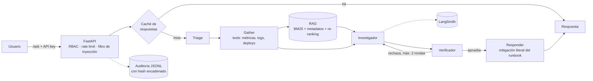

# OnCall Copilot — Informe del proyecto

Asistente multi-agente de respuesta a incidentes. Un ingeniero hace una consulta (`POST /ask`) y el sistema investiga métricas, logs y deploys, recupera runbooks y postmortems relevantes, propone una root cause verificada y devuelve la mitigación citando sus fuentes. El objetivo es reducir el tiempo que un ingeniero de guardia tarda en pasar de "algo falla" a "causa probable + acción de mitigación documentada".

## Arquitectura general

### Diagrama de flujo



### Componentes

| Componente | Función |
|---|---|
| **API (FastAPI)** | `/ask`, `/health`, `/audit/{id}`. Autenticación por API key, RBAC por servicio, límite de 20 consultas por minuto, validación de entrada. |
| **Triage** (Haiku) | Convierte la pregunta en un plan: servicio, severidad e intención (diagnóstico o mitigación). Valida que el servicio esté permitido para el usuario. |
| **Gather** | Ejecuta las herramientas operativas (`query_metrics`, `search_logs`, `recent_deploys`) sobre el escenario simulado y recupera documentos con el RAG. |
| **Investigador** (Sonnet; Opus solo si hay rechazo) | Propone root cause, categoría y citas. Si el verificador lo rechaza, reintenta con la crítica en un modelo más fuerte. |
| **Verificador** (Sonnet) | Chequeos determinísticos (ids de evidencia y citas válidos, citas coherentes con la categoría, confianza acorde) más una revisión semántica del LLM. |
| **Responder** | Entrega la mitigación copiada del runbook vigente, sin parafrasear. Si no hay evidencia suficiente, responde `inconclusive`. |
| **RAG** | BM25 sobre texto enriquecido con metadatos, filtros duros (ACL y estado vigente), filtro blando por servicio y grafo de dependencias, expansión por `related_to` y re-ranking por recencia, servicio, tipo y categoría. Cada chunk tiene id `doc_id#seccion`. |
| **Seguridad** | Filtro de inyección (EN/ES), contenido no confiable envuelto en `<untrusted>`, redacción de secretos, RBAC, auditoría con hash encadenado, presupuesto de tokens y límite de rondas. |
| **Caché y recorte de prompt** | Caché en memoria (TTL 600 s) solo para respuestas aprobadas; solo los 4 documentos mejor puntuados más los citados, truncados a 1200 caracteres. |
| **Trazabilidad** | Callback de LangChain que registra modelo, tokens, latencia y herramientas (nunca el texto de los prompts), hacia el log de auditoría y LangSmith. |

## Implementación técnica

| Área | Herramientas |
|---|---|
| Servicio web | FastAPI, Pydantic v2 |
| Orquestación | LangGraph (`triage → gather → investigate ⇄ verify → respond`) |
| LLM | LangChain `ChatAnthropic`, salidas estructuradas con JSON schema, gateway interno (Bedrock) |
| Modelos | Haiku 5.5 (triage), Sonnet 5.5 (investigador y verificador), Opus 5.5 (escalamiento) |
| Recuperación | `rank_bm25`, metadatos YAML por documento |
| Observabilidad | LangSmith y log de auditoría JSONL |
| Simulación | `simulator/scenarios.py`: 4 incidentes sintéticos con verdad conocida |
| Pruebas | pytest (29 pruebas, con LLM falso), `scripts/simulate.py` (escenarios y ataques) |
| Evaluación | `scripts/evaluate.py`, `scripts/benchmark.py`, `evaluation/metrics.py`, `evaluation/gold.py` |

Módulos principales:

```
app/api/main.py        endpoints y seguridad de entrada
app/orchestrator.py    caché, auditoría, ejecución del grafo
app/graph.py           grafo LangGraph y ruteo tras el verificador
app/agents/            triage, investigator, verifier, responder, context
app/rag/               metadata (parseo y chunking), retriever
app/security/          filters, redaction, audit
app/tools/ops.py       herramientas de métricas, logs y deploys
app/llm.py, tracing.py cliente LLM y trazabilidad
```

Si no hay `ANTHROPIC_API_KEY`, el sistema funciona con heurísticas. Cualquier error del LLM también cae a heurísticas, y queda registrado como `llm_error` en el trace.

## Evaluación

Metodología: `python scripts/evaluate.py --runs 5` contra Claude real (a través del gateway). Son 4 escenarios por 5 repeticiones, en total 20 incidentes. Cada incidente lleva una etiqueta única en el system prompt para evitar respuestas cacheadas por el gateway, de modo que las latencias son frías. Los resultados completos están en `var/evaluation.json`.

Los costos son **estimaciones a precio de lista** (USD por millón de tokens, entrada/salida: Haiku 0,10/0,50; Sonnet 2/10; Opus 4/20). El gateway puede facturar distinto.

### Performance del modelo

| Métrica | Resultado |
|---|---|
| Latencia por incidente (extremo a extremo) | p50 4,96 s · p95 6,88 s |
| Latencia por llamada, Haiku | p50 1,56 s · p95 2,42 s |
| Latencia por llamada, Sonnet | p50 2,05 s · p95 3,11 s |
| Latencia por llamada, Opus (1 llamada) | 5,77 s |
| Tokens (entrada / salida) | 61.933 / 8.185 en 20 incidentes (~3.100 / ~410 por incidente) |
| Llamadas por modelo | Haiku 20 · Sonnet 41 · Opus 1 |
| Costo | $0,169 en total, **$0,0085 por incidente** |
| Errores del LLM | 0 |

Precisión semántica de la root cause contra la causa de referencia del escenario:

| Métrica | Promedio |
|---|---|
| BLEU-4 (con suavizado) | 0,08 |
| ROUGE-1 / ROUGE-2 / ROUGE-L (F1) | 0,28 / 0,12 / 0,26 |
| Similitud coseno TF-IDF | 0,37 |
| **LLM-as-judge** (Haiku, 0 a 1) | **0,81** |

Por escenario, juez y coseno TF-IDF:

| Escenario | Juez | Coseno TF-IDF |
|---|---|---|
| `tls_expiry` | 0,95 | 0,49 |
| `bad_deploy` | 0,93 | 0,43 |
| `db_pool_exhaustion` | 0,92 | 0,33 |
| `oom_killed` | 0,43 | 0,23 |

Lectura: BLEU y ROUGE son bajos porque la referencia es una frase de ~12 palabras y el modelo responde con 1 o 2 oraciones más ricas; miden solapamiento léxico, no corrección. El juez semántico (0,92 a 0,95 en los casos con causa conocida) es el indicador más representativo. `oom_killed` puntúa bajo intencionalmente: no existe runbook y el sistema responde `inconclusive` en lugar de afirmar una causa; la referencia (fuga de memoria) y la hipótesis (OOMKilled repetido) solo coinciden parcialmente.

### Performance de los agentes

| Métrica | Resultado |
|---|---|
| Coherencia: categoría correcta | 100 % (20/20) |
| Coherencia: estado correcto (`approved` / `inconclusive`) | 100 % |
| Mitigación correcta (id de runbook esperado, o ninguna) | 100 % |
| Respuestas fundamentadas (citas y evidencia existentes) | 100 % |
| Decisión del verificador coherente con la verdad | 100 % |
| Auto-consistencia entre repeticiones | 100 % |
| Aprobadas en la primera ronda | 95 % (promedio 1,05 rondas) |

Latencia por agente (p50 / p95): triage 1,57 / 2,43 s · investigador 2,60 / 3,21 s · verificador 0,81 / 0,92 s · recolección de evidencia (herramientas y RAG) 9 / 11 ms · responder ~0 ms.

**Calidad del diálogo investigador y verificador.** En los casos normales casi no hay diálogo (solo 1 de 20 incidentes necesitó una segunda ronda), así que se agregó una **sonda de desafío**. A cada uno de los 3 escenarios con causa conocida se le inyectan dos hipótesis defectuosas: una con categoría equivocada y otra con una afirmación sin respaldo en la evidencia (un disco defectuoso). Son 6 sondas.

| Métrica de la sonda | Resultado |
|---|---|
| Rechazo de categoría equivocada | 100 % |
| Rechazo de afirmación sin respaldo | 100 % |
| Especificidad de la crítica (juez, 0 a 1) | 0,88 |
| Recuperación del investigador tras la crítica | 100 % (6/6), con confianza media 0,87 |

**Redundancia evitada.**

| Mecanismo | Resultado |
|---|---|
| Caché de respuestas | La segunda consulta idéntica tarda 1 ms en lugar de ~4 s y ahorra ~3.500 tokens (el costo de un incidente completo) |
| Recorte de prompt | -7 % de caracteres de documentos (el corpus es pequeño; ahorra más con uno grande) |

### Eficiencia del RAG

Conjunto de prueba: 8 consultas etiquetadas sobre 12 chunks vigentes y 1 superseded.

| Métrica | Resultado |
|---|---|
| Precision@1 / @3 / @5 | 0,75 / 0,33 / 0,25 |
| Recall@1 / @3 / @5 | 0,75 / 0,88 / 1,00 |
| MRR | 0,88 |
| Tiempo de recuperación | 0,05 ms (p95 0,06 ms) |
| Cobertura de contexto útil | 89 % de los chunks necesarios llegan al prompt |
| Densidad de contexto útil | 67 % de los documentos del prompt son útiles |
| Fuga entre servicios (ACL) | 0 |
| Fuga de documentos obsoletos | 0 |

Nota: cada consulta tiene solo 1 o 2 chunks relevantes, así que Precision@3 y @5 tienen un techo de ~0,42 y ~0,25; sus valores son casi el máximo posible, no una debilidad. La cobertura de 89 % indica un chunk útil (el postmortem) que a veces queda fuera de los 4 documentos mostrados.

## Resultados y ejemplos

Resultado por escenario (corridas reales, 5 por escenario):

| Escenario | Esperado | Obtenido | Mitigación citada |
|---|---|---|---|
| `db_pool_exhaustion` (payments) | approved | approved, 5/5 | `rb-payments-db-pool#mitigation` |
| `bad_deploy` (orders) | approved | approved, 5/5 | `rb-bad-deploy-rollback#mitigation` |
| `tls_expiry` (auth) | approved | approved, 5/5 | `rb-tls-cert-expiry#mitigation` |
| `oom_killed` (api-gateway) | inconclusive | inconclusive, 5/5 | ninguna |

Ejemplo (`bad_deploy`):

> **root cause:** El deploy dep-orders-2.14.0 (nuevo motor de precios) en el minuto 37 introdujo una NullPointerException en `PricingEngine.compute`, disparando el error rate y la latencia desde el minuto 38.
> **Citas:** `rb-bad-deploy-rollback#diagnosis`, `rb-bad-deploy-rollback#mitigation`
> **Mitigación:** `deploy rollback orders-service`; confirmar que el error rate vuelve a la línea base y abrir un ticket al autor del cambio.

Ejemplo de abstención (`oom_killed`): el sistema responde "Inconclusive" con confianza <= 0,4, describe la mejor hipótesis y **no** inventa una mitigación, porque no hay runbook aplicable.

Seguridad (`simulate.py attacks`): 7/7 defensas aguantaron. Cubren inyección directa en inglés y español, entrada sobredimensionada, falta de API key, acceso entre equipos, acceso no admin a la auditoría e inyección dentro de un log.

Optimización de costo: tras recortar el prompt y escalar a Opus solo tras un rechazo, el uso de Opus pasó de 81 % a ~0 % de las llamadas (1 de 62 en esta evaluación).

## Conclusiones y mejoras futuras

**Conclusiones**

- El pipeline resuelve correctamente los 4 escenarios de forma consistente, con fuentes citadas y mitigación tomada literalmente del runbook, a ~$0,0085 y ~5 s por incidente.
- La autoevaluación funciona: el verificador rechazó el 100 % de las hipótesis defectuosas inyectadas y el investigador se recuperó en todas.
- El sistema se abstiene cuando no hay evidencia (`oom_killed`) en lugar de alucinar.
- El RAG recupera lo necesario (recall@5 = 1,0) sin fugas de ACL ni documentos obsoletos.

**Limitaciones**

- Los datos son sintéticos y pequeños: 4 escenarios, 12 chunks y 8 consultas. Los porcentajes del 100 % muestran que el sistema cumple su diseño, pero no son una garantía de rendimiento en producción.
- BLEU y ROUGE tienen poco valor con referencias cortas; se complementan con el juez, pero este es otro LLM y puede tener sesgo.
- Al repetir pedidos idénticos se observaron latencias de ~200 ms por llamada, compatibles con una caché del lado del gateway. Las métricas de latencia se tomaron con una etiqueta única por incidente.
- El costo es una estimación a precio de lista.

**Mejoras futuras**

- Disparo automático desde alertas y una acción final automática (por ejemplo, abrir un ticket o ejecutar un rollback con aprobación humana).
- Un corpus y un conjunto de escenarios mayores, con casos ambiguos y de varios servicios.
- Un retriever híbrido (BM25 más embeddings) y un reranker, evaluado con el mismo harness.
- Prompt caching de Anthropic para el prefijo estable, y una caché de respuestas acotada y compartida entre procesos.

## Cómo reproducir

```bash
export ANTHROPIC_API_KEY=...
.venv/bin/python -m pytest -q                   # 29 pruebas, sin LLM real
.venv/bin/python scripts/simulate.py run all    # escenarios
.venv/bin/python scripts/simulate.py attacks    # seguridad
.venv/bin/python scripts/evaluate.py --runs 5   # métricas de modelo, agentes y RAG
```
